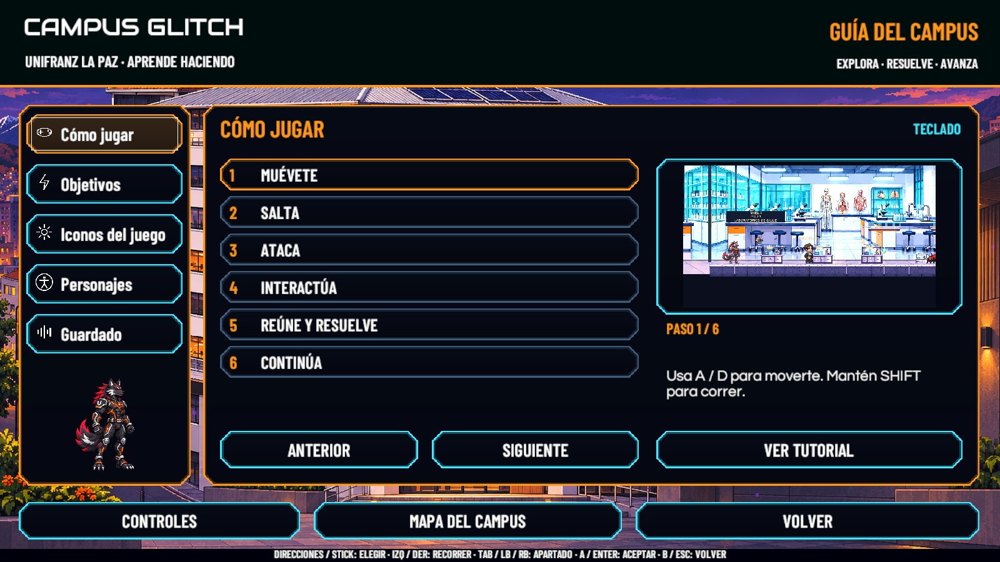
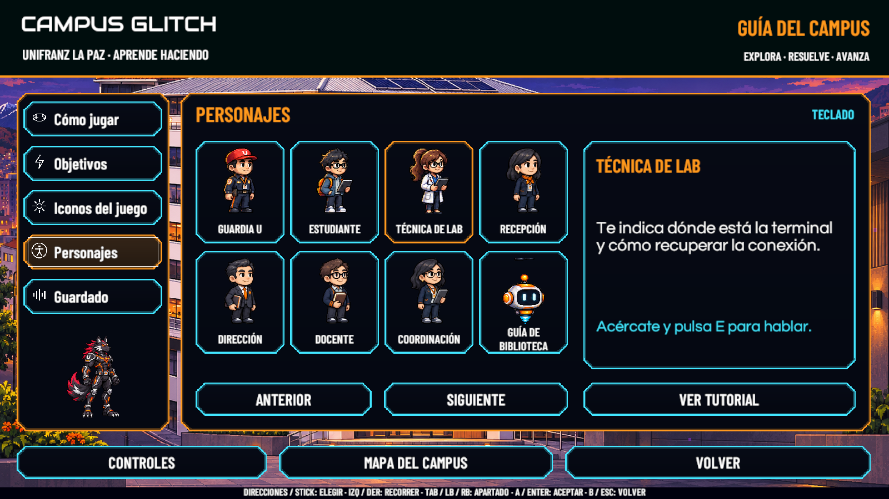
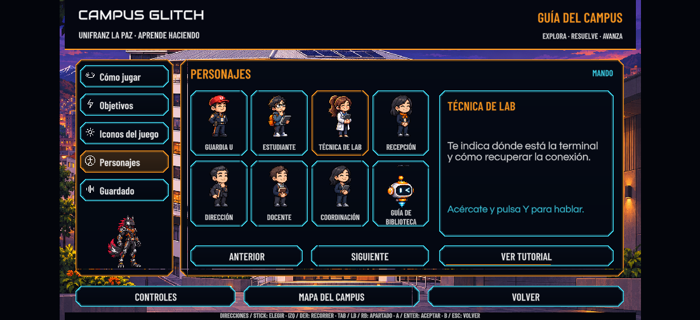

# Ayuda — 10 de noviembre de 2026

Unity 6000.3.16f1, Windows, rama `feature/victor-integracion`. Revisión de interfaz; no se recorrieron niveles jugables.

**47 comprobaciones correctas, 0 fallos**, con teclado y mando virtuales. Se comprobaron los cinco apartados, acceso independiente a Controles, instrucciones con botones reasignados, diez objetivos, ocho personajes, imágenes de objetos, recorrido automático y su interrupción, vuelta al menú, acceso real al mapa, reducción de destellos y encuadre 16:9, 4:3 y ultrapanorámico. El progreso y sus tres archivos se restauraron; la comparación por SHA-256 coincide con el respaldo.

La ejecución final no añadió entradas a la consola conservada (cursor 108 antes y después). La compilación no tiene errores; los avisos anteriores están documentados en Configuración. El comprobador histórico de menús se adaptó al nuevo acceso de Controles, sin repetir su recorrido por niveles.

[Resultados](Ayuda20261110/Resultados.txt)

Se incluyen capturas de Objetivos, Iconos y Guardado. Las imágenes de Scene usan el progreso original restaurado; la de Play usa datos temporales aislados.

Para repetir: guardar la escena, detener Play y ejecutar `CampusGlitch.Editor.CGHelpRegression.Run("RUTA_EXTERNA_NUEVA")`. La carpeta debe ser nueva y estar fuera del proyecto. El comprobador conserva los guardados y vuelve a la escena original.

Pendientes: revisión independiente, mando físico y revisión del ejecutable actualizado. Esta comprobación no certifica la jugabilidad de los niveles ni el funcionamiento táctil en teléfono.
