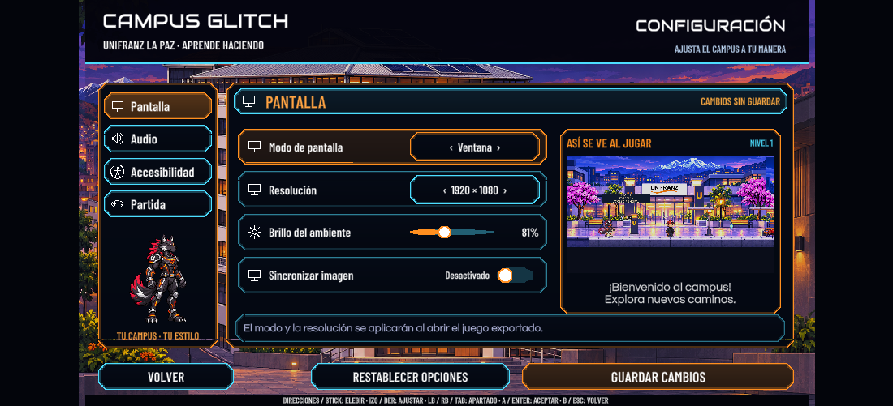
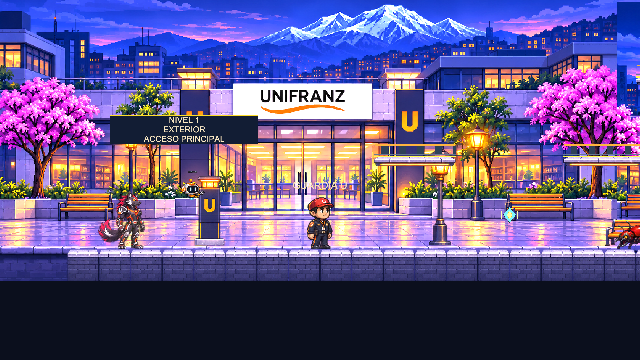

# Configuración — revisión del 10 de noviembre de 2026

Rama `feature/victor-integracion`, Unity 6000.3.16f1 en Windows. Implementación: `97905d2` y `1acf4d8`.

**Resultado: 45 comprobaciones correctas, 0 fallos.** La ejecución final no añadió errores ni advertencias a la consola conservada. La compilación no tiene errores y mantiene los cuatro avisos anteriores sobre `ContactFilter2D.NoFilter()` y `CGFrameAnimator.lastState`.

Se comprobaron teclado y mando virtuales, cuatro apartados, borradores, guardado y lectura del archivo, valores antiguos, límites, silencio, cuatro volúmenes, música y sonidos reales, señal del indicador, confirmaciones, cancelación del borrado, conservación de botones y recuperación de la pantalla al caducar una confirmación.

La vista genera el nivel con el mismo constructor que el juego. La comprobación verifica que tiene Guardián, personajes y escenario iluminado, que se actualiza, que no modifica la cámara principal y que no ejecuta física ni recibe controles. Al salir se comprueba que no quedan mundos temporales ni luces globales adicionales. Los errores detectados durante la preparación de esa vista quedaron corregidos antes de registrar la implementación; los registros históricos no se borraron para ocultarlos.

Los tres archivos originales de progreso fueron respaldados y restaurados. Se comprobó su contenido por hash. Los archivos privados de guardado no se publican.

También se repitieron Controles (**39 correctas, 0 fallos**) y Créditos (**31 correctas, 0 fallos**) después de incorporar las opciones compartidas de sonido y lectura.

[Resultados completos](Configuracion20261110/results.txt)

La prueba utiliza progreso aislado para comprobar la pantalla y sus acciones. No constituye un recorrido jugable de los niveles. El modo y la resolución físicos de Windows, el ejecutable actualizado, un mando físico y los dispositivos móviles requieren comprobación aparte. En el editor se comprueba la confirmación y su recuperación sin modificar la pantalla del equipo.

Para repetir: guardar la escena, detener Play y ejecutar `CampusGlitch.Editor.CGSettingsRegression.Run("RUTA_EXTERNA_NUEVA")`. La carpeta debe ser nueva y estar fuera del proyecto. El comprobador conserva y restaura los archivos, la escena, las opciones de entrada y los valores de sonido y sincronización previos.
