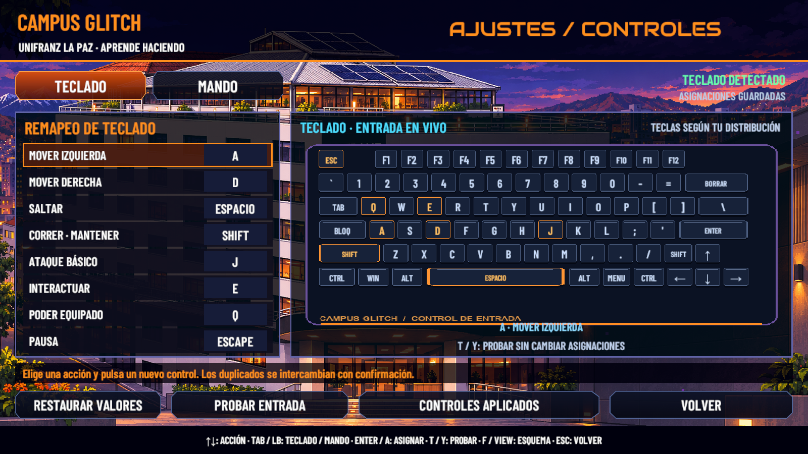
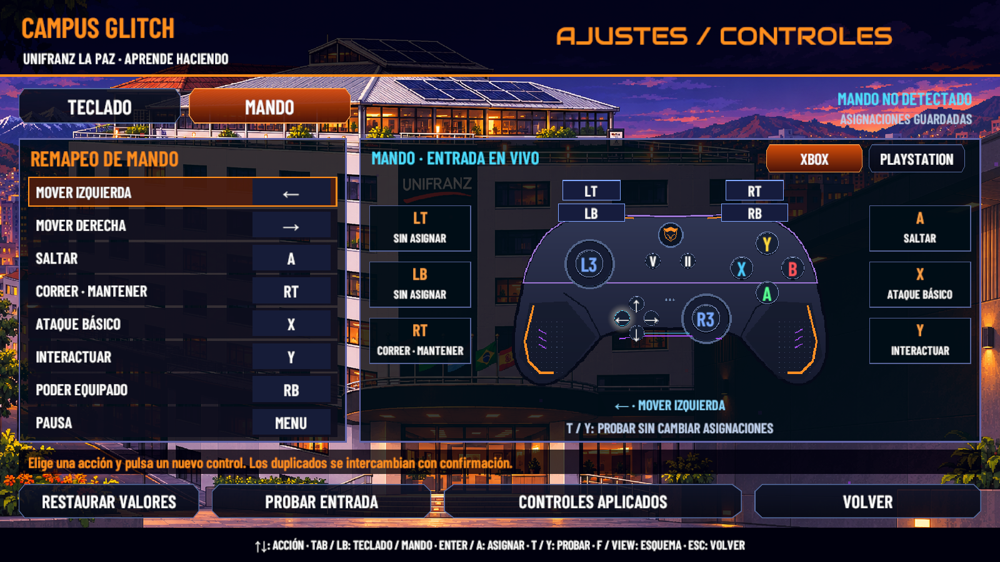
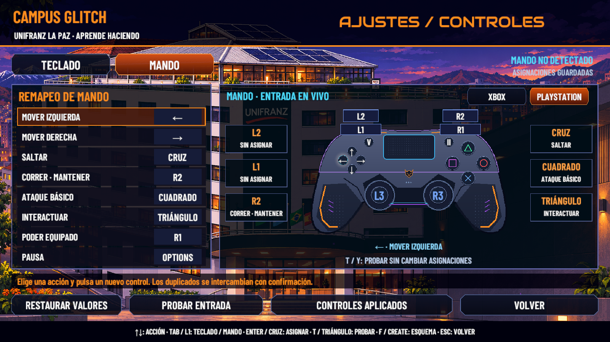
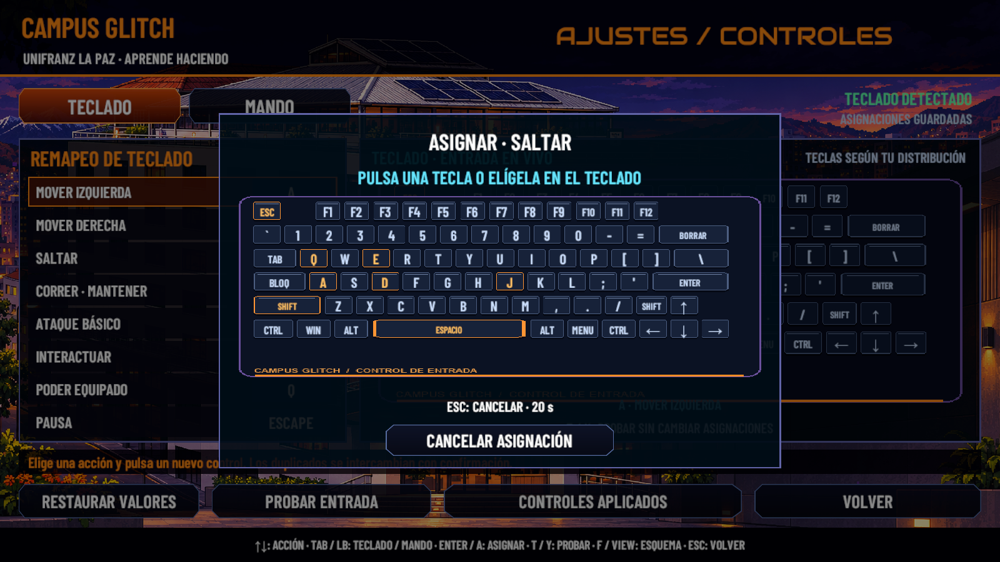

# Verificación de Controles

10 de noviembre de 2026 · Unity 6000.3.16f1 · Windows/DX12 · `feature/victor-integracion`. Arte inicial `8d8d037`; interfaz y entrada `12ce373`.

## Comprobaciones ejecutadas

| Área | Resultado |
|---|---|
| Compilación de scripts | Completada, 0 errores y 0 advertencias del compilador. |
| `CGControlsRegression` en PlayMode | **39 PASS, 0 FAIL**. |
| Archivos de progreso | Archivo principal, respaldo y temporal restaurados; hashes anteriores y posteriores iguales. |
| Teclado, Xbox, PlayStation y captura de tecla en Scene | Capturas reales antes de Play a 1600 × 900, botones y textos completos. |
| Consola durante la revisión final de las cuatro vistas | 0 entradas nuevas de error desde cursor 2090 de la sesión de revisión. La consola histórica se conservó y no se declara vacía. |
| Lector oficial de Aseprite en Unity | Acepta mando de ocho capas/ocho frames y teclado de cuatro frames. |

Los casos positivos comprueban captura tras soltar el control inicial, borradores, cancelación, tiempo límite, intercambio explícito de duplicados, restauración, guardado y recarga desde archivo. Incluyen gatillo analógico asignado a Habilidad, estado mantenido y ausencia de repetición continua de la activación.

Se utilizaron dispositivos virtuales del Input System para comprobar detección de Xbox/XInput y PlayStation/DualShock, los símbolos correspondientes, iluminación de gatillo, pulsación y desvanecimiento de teclas, selección de tecla desde el dibujo y carga de los recursos. No se declara probado un mando físico o una conexión Bluetooth.

La primera repetición identificó borradores que podían conservar estado de la presentación de edición: `CGGame.Start` ahora inicializa Controles al entrar en ejecución. El arnés utiliza ratón, teclado y mando virtuales para evitar que el puntero real altere la selección. Otra comprobación detectó imágenes nuevas del teclado pendientes de importación; se importaron explícitamente, se preservaron sus `.meta` y se repitió el arnés completo. El resultado aceptado es el último registro positivo, no los intentos anteriores.

## Presentación final

Los tres dispositivos tienen esquemas propios. La detección se comunica con el nombre disponible del dispositivo; sin mando se muestra **Mando no detectado**. Xbox y PlayStation siguen siendo seleccionables para consultar el esquema. No hay opción Auto.









Registro ejecutado: [39 comprobaciones](Controles20261110/resultados.txt). Fuentes editables, controles y referencias oficiales: [Controles editables](../Arte/CONTROLES_EDITABLES.md).

## Repetir la comprobación

Abrir el proyecto, esperar la importación y compilación, guardar la escena abierta y detener Play. Ejecutar el arnés con una carpeta nueva fuera del proyecto:

```csharp
CampusGlitch.Editor.CGControlsRegression.Run("C:/QA/Controles-01");
```

El arnés abre `SC_Controls`, crea dispositivos virtuales y guarda sus resultados fuera del repositorio. Al regresar a edición restaura los tres archivos de progreso y la escena previa. Los respaldos de partidas quedan fuera de las evidencias públicas.

Esta fase no modifica niveles ni valida ejecutables nuevos. Queda pendiente la prueba con dispositivos físicos, teclados de otras distribuciones y mandos HID sin un perfil Gamepad reconocido. No se ejecutaron regeneradores de escenas. El ajuste local de `SC_MainMenu.unity` se conserva fuera de los commits de esta fase.
