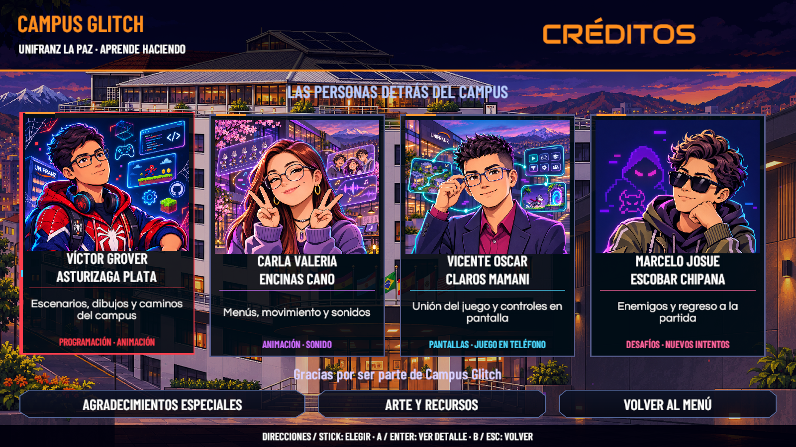
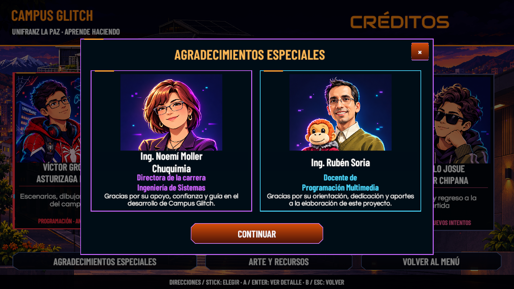
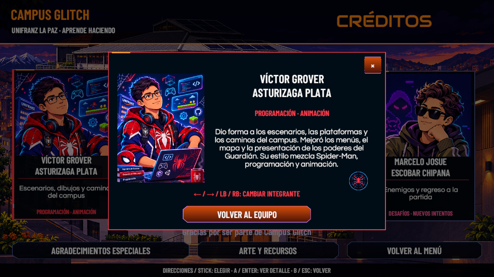
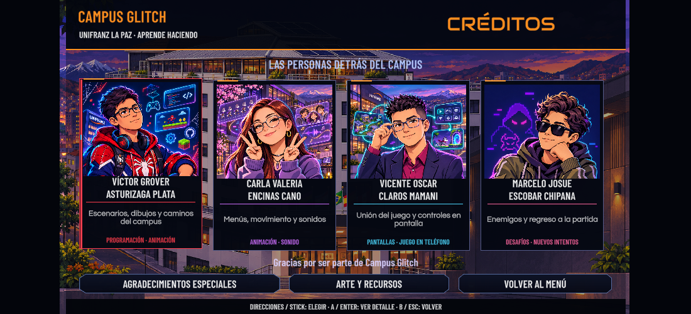

# Revisión de Créditos — 10 de noviembre de 2026

Rama: `feature/victor-integracion`. Cambios visuales y de interacción: `6cfb220` y `4b24a33`. Unity 6000.3.16f1, Windows, escena `SC_Credits`. Esta revisión cubre la presentación y sus ventanas; no recorre niveles del juego.

## Resultado

- **31 comprobaciones correctas y 0 fallos** en PlayMode, con teclado y mando virtuales.
- Los seis retratos están conectados. Víctor utiliza la imagen que entregó el usuario; Marcelo conserva lentes negros; Carla y Vicente tienen fondos del campus relacionados con su trabajo.
- Enter/A abre perfiles y agradecimientos; Escape/B cierra solamente la ventana abierta y devuelve el foco. Flechas y LB/RB recorren integrantes.
- Volver desde Créditos abre el menú principal sin activar la entrada de niveles.
- Los tres archivos de progreso conservan su contenido y presencia originales, comprobados por hash después de la ejecución. Los respaldos privados no se incluyen en este repositorio.
- Se comprobó el encuadre proporcional para 1280×720, 1024×768 y 2560×1080 mediante la función de distribución. La captura real de Play tiene 1100×501 y conserva la pantalla completa con márgenes laterales.
- La compilación final no tiene errores. Durante la recompilación aparecen cuatro avisos existentes: tres usos antiguos de `ContactFilter2D.NoFilter()` y el campo `CGFrameAnimator.lastState` sin lectura. La ejecución final y las capturas no añadieron entradas de error o advertencia a la consola conservada.

## Evidencia

[Resultados de las comprobaciones](Creditos20261110/Resultados.txt) · [Conservación del progreso](Creditos20261110/Guardado.txt)

También se incluyen las capturas de Marcelo y Arte y recursos. Las imágenes de Scene son capturas de cámara a 1600×900; la de Play procede de la ejecución del juego.

## Repetir la comprobación

Guardar la escena, detener Play y ejecutar desde el editor `CampusGlitch.Editor.CGCreditsRegression.Run("RUTA_EXTERNA_NUEVA")`. El comprobador respalda los tres archivos de progreso, abre Créditos, utiliza dispositivos virtuales y restaura los archivos y la escena original al terminar. Debe usarse una carpeta externa nueva.

Pendientes: revisión por otra persona, mando físico y comprobación en un ejecutable actualizado. Los cambios locales de cámara existentes se conservaron y no forman parte de estos commits.
