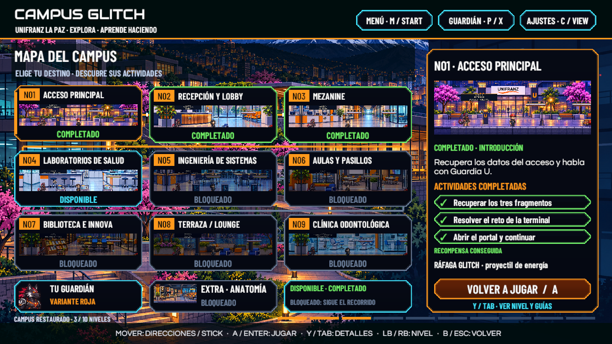
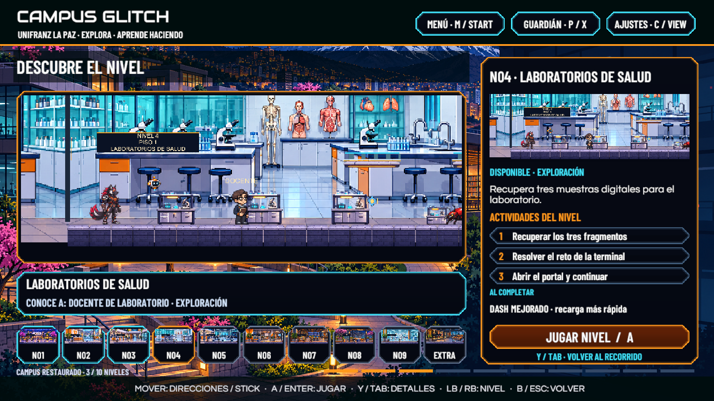
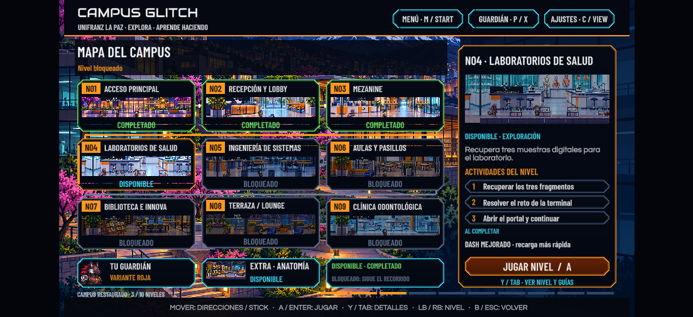

# Mapa y actividades — 10 de noviembre de 2026

Unity 6000.3.16f1, Windows, rama `feature/victor-integracion`. Revisión de distribución y navegación; no se recorrieron los niveles.

**37 comprobaciones correctas, 0 fallos**, con teclado, stick y cruceta virtuales. Se comprobaron los diez destinos y sus actividades, distribución sin tarjetas superpuestas, recompensas, niveles bloqueados, ruta extra, progreso completado, detalles, cambios de destino y accesos reales a Personalización, Configuración y menú. Los guardados originales se restauraron y se compararon por hash.

La ejecución completa final no añadió errores ni advertencias a la consola conservada. La compilación no tiene errores y mantiene los cuatro avisos existentes ya documentados en Configuración. La comprobación histórica del menú se adaptó al nuevo apartado de borrado de avance; no se volvió a ejecutar su recorrido completo por niveles.

[Resultados reproducibles](Mapa20261110/Resultados.txt)

Las capturas de Scene muestran el progreso original restaurado. La captura Play utiliza únicamente los datos temporales del comprobador. También se incluyen el acceso principal y el extra bloqueado.

Para repetir: guardar la escena, detener Play y ejecutar `CampusGlitch.Editor.CGMapRegression.Run("RUTA_EXTERNA_NUEVA")`. La carpeta debe ser nueva y estar fuera del proyecto. La prueba conserva los tres archivos de progreso y la escena original.

Pendientes: revisión por otra persona, mando físico y ejecutable actualizado. Esta revisión no certifica la jugabilidad completa ni el equilibrio de las actividades de los diez niveles.
