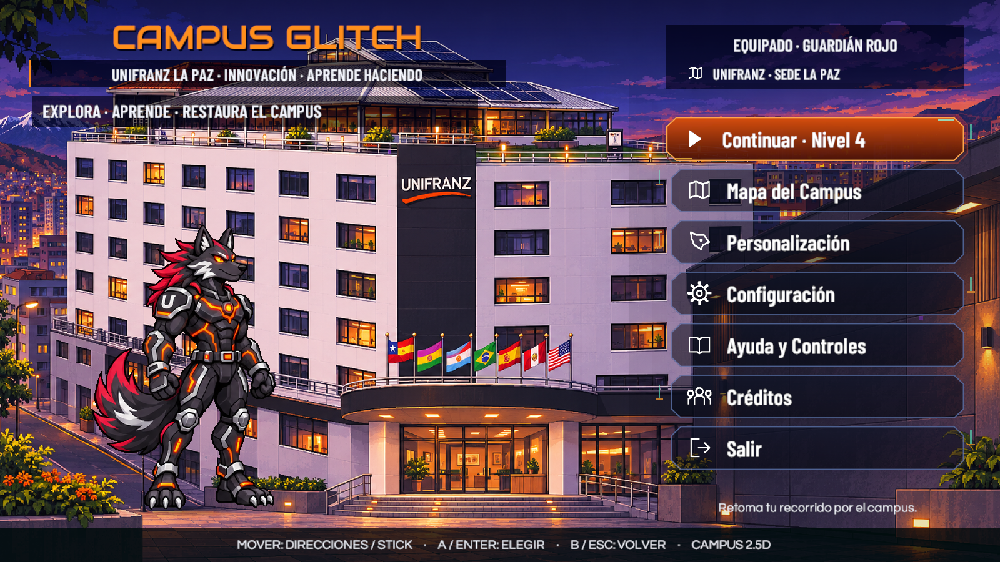
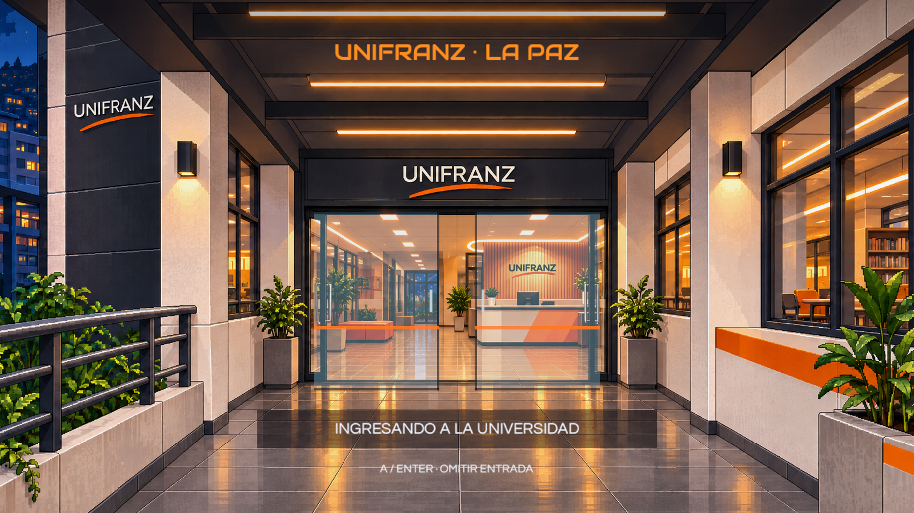

# Revisión visual del menú

Unity 6000.3.16f1, Windows, DX12. Código revisado: `335a16e`, rama `feature/victor-integracion`.

| Comprobación | Resultado |
|---|---|
| Compilación de scripts | Completada; 0 errores |
| Shader `Hidden/CampusGlitch/MenuGlitch` | Compatible en el editor; 0 mensajes del compilador de shader |
| Rótulo «Vista previa» en la composición del menú | Ausente |
| Caracteres decorativos de código | 0; se utilizan destellos y distorsión de imagen |
| Edición del título desde el diseño compartido | Comprobada, restaurando el valor original |
| Presentación del ingreso en edición | Disponible desde Inspector; hojas de cristal separadas del fondo |
| Cámara principal de interfaz | Ortográfica, tamaño 3,6; centro (0, 0) |
| Estado de la escena tras comprobar el diseño | Sin cambios pendientes de guardado |

El retrato tiene un pulso de fallos RGB, desplazamiento de franjas y transición entre variantes. Se observaron capturas en ejecución de corte, separación de color, bandas y retrato estable, manteniendo `SC_MainMenu`. Los atlas originales del personaje jugable conservan sus hashes.

La revisión del flujo de ventanas registró menú → carga de Configuración → Configuración → menú, con `loadingLevel=False` en todos los pasos. El acceso arquitectónico está reservado a `ChooseLevel`, que solicita la transición con `levelEntry=true` después de comprobar el desbloqueo. El modo de efectos reducidos elimina las distorsiones y el cambio automático del retrato.

Las capturas siguientes proceden de la cámara principal con el Canvas de edición, a 1600 × 900. Muestran los elementos reales de la escena antes de Play:

Esta revisión se limita a presentación e interfaces. No se ejecutaron pruebas nuevas de niveles jugables durante esta fase ni se certifica un nuevo ejecutable Windows, Android o mando físico. Los informes anteriores de física y recorridos son cortes independientes; la revisión externa de los PR sigue pendiente.

Edición y referencias: [Menú editable](../Arte/MENU_EDITABLE.md).
