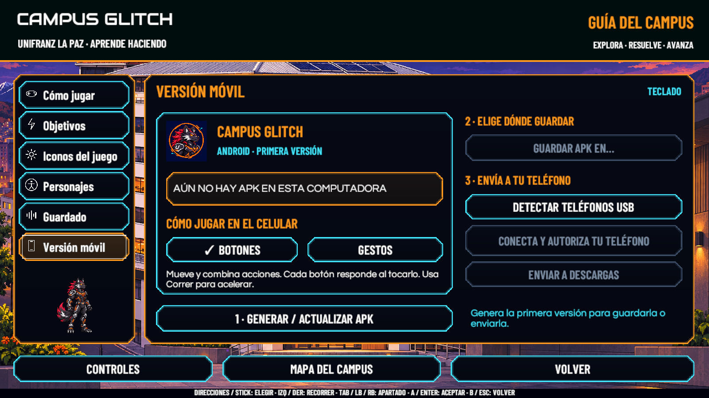
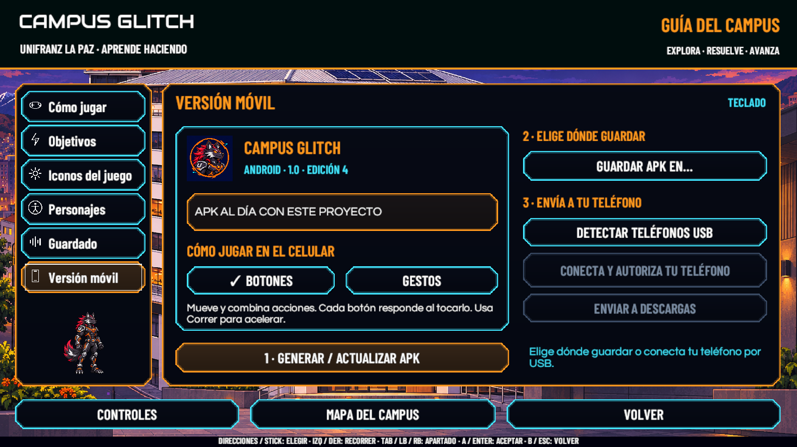
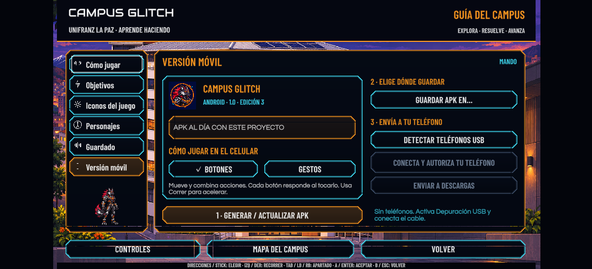
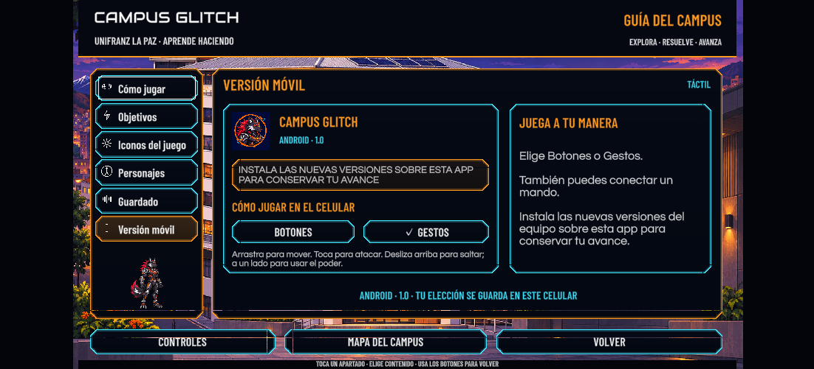

# Versión móvil local — 10 de noviembre de 2026

Unity 6000.3.16f1, Windows, rama `feature/victor-integracion`. Esta entrega amplía la ayuda con Versión móvil, exportación local y controles táctiles. La APK no se publica en GitHub.

**66 comprobaciones correctas, 0 fallos** en la ejecución final de Ayuda y móvil. Se conservan las 47 comprobaciones de la guía y se añaden definición del icono, lectura única de toques breves, selección de teléfono, cancelación, autorización, copia e integridad, botones y gestos, márgenes seguros y entrada simultánea con dos dedos virtuales. Las comprobaciones de copia usan un archivo aislado claramente identificado como ejemplo, sin instalarlo. Los guardados originales se restauran al terminar.

[Resultados reproducibles](Movil20261110/Resultados.txt)

La interfaz presenta generar, guardar y enviar en orden; las acciones no disponibles se atenúan y no reciben foco. El selector USB abre una lista y permite cancelar. Las fuentes y colores son los del juego; el foco se anima en pasos limitados para reutilizar los marcos. La vista de Scene comparte el mismo dibujo de Play.

Las pruebas de USB incluyen listados aislados de ejemplo con estados listo, pendiente y desconectado. La consulta real de esta laptop no encontró teléfonos disponibles para depuración USB; no se afirma envío ni instalación físicos. La prueba con dos dedos usa Unity Input System, sin ejecutar un nivel jugable.

[Uso y actualización de versiones](../Arte/VERSION_MOVIL_LOCAL.md)

Pendientes de revisión en teléfono: instalación, actualización sobre una versión anterior conservando avance, gestos físicos, rendimiento, áreas seguras reales y mando conectado por Bluetooth. También se requiere revisión de otra persona antes de integrar el PR.

## Primera exportación real

La primera APK se generó con 0 errores y 213 advertencias, 100,3 MiB, IL2CPP/ARM64 y las 18 escenas habilitadas. Android identifica `com.unifranz.campusglitch`, nombre **Campus Glitch**, versión 1.0, código 2, mínimo API 25 y destino API 36. `apksigner verify` confirmó una firma local Android Debug; no es una publicación de tienda. `aapt dump badging` confirmó los iconos de los seis tamaños del paquete. El destino original Windows se restauró al terminar.

La inspección completa encontró avisos de componentes de la maqueta antigua incluidos al compilar, además de avisos de shaders y paquetes de Unity; no se afirma ausencia de avisos en el build. Se corrigió un aviso temporal del menú al dibujar el icono antes de terminar su importación. La revisión final de scripts conserva los cuatro avisos existentes documentados en Configuración. La ejecución final de las 66 comprobaciones no añadió entradas nuevas de error o advertencia a la consola conservada.

## Edición final y guardado desde la interfaz

La edición previa 1.0, código **3**, se generó con 0 errores y 213 advertencias en 7 min 49 s. Incluye los ajustes finales de selección, entrada táctil e imágenes. La firma y los seis iconos se comprobaron otra vez. Se conservó la edición anterior hasta terminar correctamente la nueva.

Se abrió **Guardar APK en…** desde Play mediante el ratón, se eligió Descargas en el selector nativo de Windows y el menú confirmó la copia. Ambos archivos coinciden por SHA-256. También se pulsó Detectar teléfonos USB desde el juego; respondió sin dispositivos de depuración disponibles y mantuvo desactivado el envío. No se instaló nada ni se copió a un teléfono. El selector de carpeta está comprobado en el Editor de Windows; falta repetirlo en el ejecutable Windows actualizado.

[Reporte del build final](Movil20261110/Reporte_Build_Android.txt) · [Identidad, firma e integridad](Movil20261110/Verificacion_APK.txt)

La simulación táctil restaura las preferencias originales sin guardarlas. Unity terminó detenido en SC_Help y recuperó el destino Windows. La APK y la copia de Descargas permanecen únicamente en esta computadora.

## Filtro de maquetas al exportar

Se detectaron componentes serializados de las maquetas antiguas que no pertenecen al mundo construido al jugar. `CGBuildPreviewFilter` retira únicamente las tres raíces conocidas de presentación del Editor en la copia de escena utilizada por el build. Los archivos de escena y la vista antes de Play se conservan.

La comprobación aislada retiró las tres raíces con sus hijos, mantuvo dos objetos ajenos y sus hijos y confirmó que el callback sin build no altera la escena. Los 18 archivos de escena conservaron su SHA-256 durante la comprobación. No se ejecutaron recorridos de niveles.

## Actualización del 11 de noviembre: edición 4

La exportación con el filtro terminó **Succeeded, 0 errores y 22 advertencias**, en 3 min 04 s; APK de **100,1 MiB**, versión **1.0 (4)**. Los avisos de componentes de la maqueta anterior ya no aparecen. Los 18 archivos de escena conservan exactamente su SHA-256 anterior; no se regeneró ni reescribió ninguna escena.

Se repitieron las verificaciones de identidad, iconos y firma con las herramientas Android del SDK. La copia de Descargas se actualizó a la edición 4 y coincide con la APK final por SHA-256. El reporte y la imagen de Scene se renovaron. Las capturas de Play y del diseño táctil corresponden a la edición 3, cuyo funcionamiento de interfaz es el mismo; el cambio de la edición 4 afecta al contenido retirado durante la exportación.
