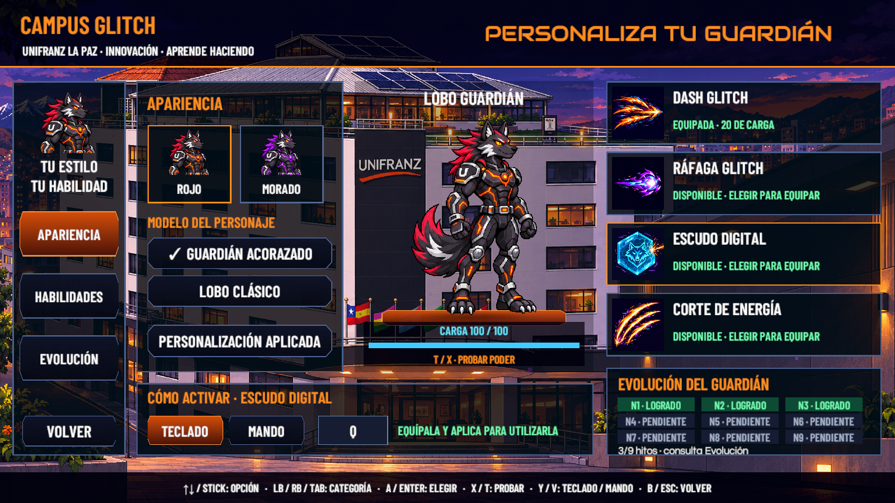
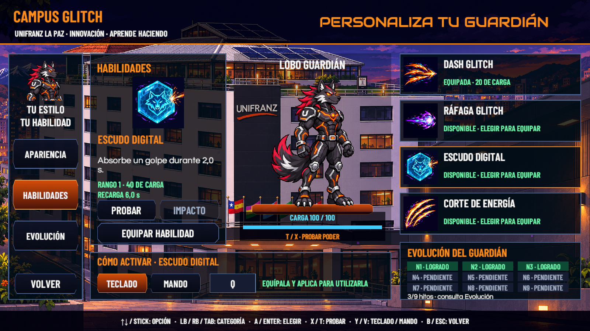
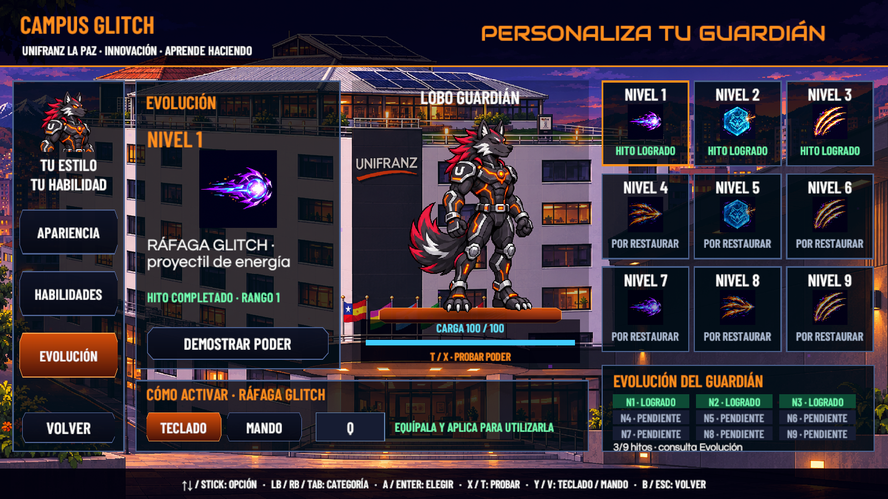
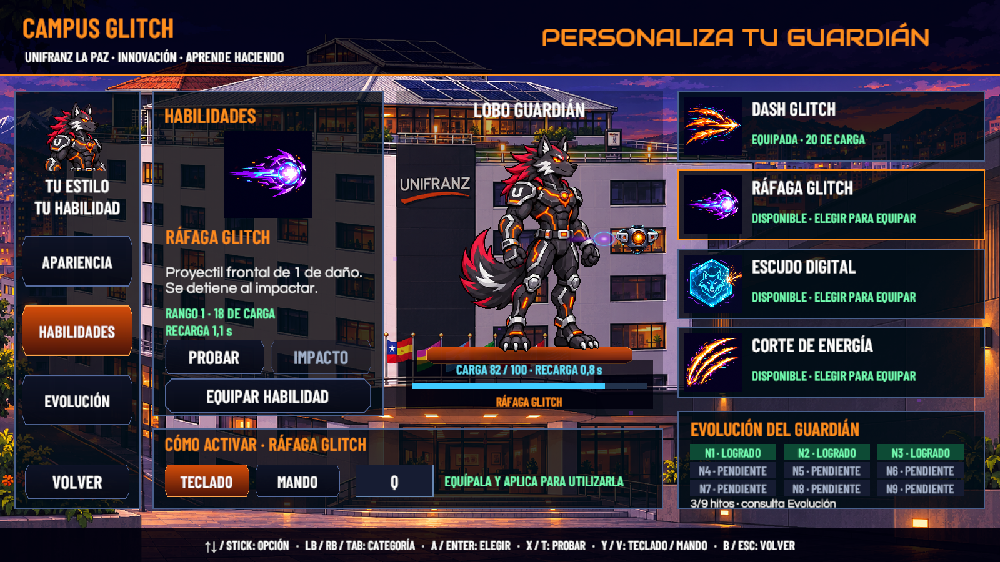
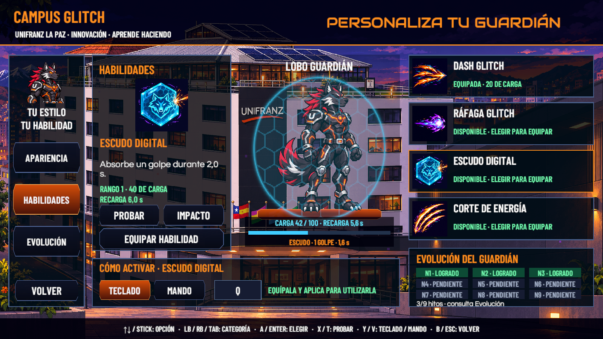
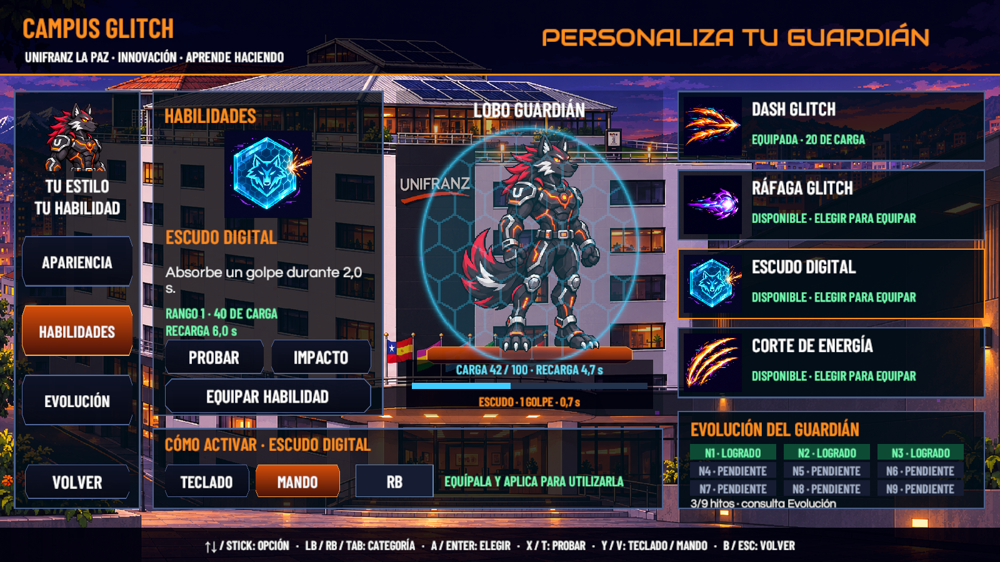

# Personalización, poderes y activación

Verificación del 10 de noviembre de 2026 en Unity 6000.3.16f1, Windows/DX12. Rama `feature/victor-integracion`; poderes `dacc4fe`, personalización `f9388c5` y corrección tipográfica `00f8d00`.

## Resultado ejecutado

| Comprobación | Resultado |
|---|---|
| Compilación final de scripts | 0 errores, 0 advertencias del compilador |
| `CGAbilityRegression` en PlayMode, escenario físico aislado | **67 PASS, 0 FAIL** |
| `CGCustomizationRegression` en PlayMode, teclado y mando virtual | **31 PASS, 0 FAIL** |
| Asignación temporal de Habilidad a `K` y `buttonWest` | El dibujo mostró `K` en Teclado y `X` en Mando. Se restauraron las asignaciones, sin guardar. |
| Textos retirados | Ausentes «Configuración guardada» y la categoría «Efectos» en la composición capturada |
| Botones de distintos acentos dentro del mismo dibujo | Referencias de texturas válidas; sin bloques blancos en las capturas de Scene |
| Cuatro ilustraciones importadas | 512 × 512, Point, sin mipmaps, límite 512 |
| Archivos de progreso antes/después del arnés | Hashes idénticos; se restauraron el archivo principal, respaldo y temporal |

Los 67 casos cubren los nueve hitos, compatibilidad de serialización, bloqueos, duración y recarga, consumo y regeneración de energía, absorción del escudo y el controlador real en una escena física local. El dash avanza y se detiene ante un collider sólido; el corte aplica daño una sola vez a un enemigo con dos colliders, respeta obstáculos y no golpea a espaldas del personaje. La ráfaga dispara según la orientación, se detiene ante paredes, impacta una sola vez y aplica el daño mejorado de N7. Se comprueba que su movimiento se detiene y continúa al pausar/reanudar. La cúpula visual envuelve las dimensiones de la cápsula del personaje.

Los 31 casos de interfaz comprueban navegación por cruceta/RB/Tab, selección del tipo de instrucciones con `V`/`Y`, carga de ilustraciones, demostración del escudo y su impacto, ráfaga con consumo/recarga, protección de habilidades/variantes bloqueadas, borrador, confirmación de salida, aplicación y recarga desde el archivo real. Equipar utiliza el poder inspeccionado aunque no se haya pulsado primero su tarjeta. Observar o demostrar no escribe guardados ni concede hitos.

La repetición del ataque frontal detectó una diferencia entre el Transform y la posición física al reposicionar un Rigidbody2D en el arnés. Se corrigió el origen del ataque para consultar la posición física. La repetición final es el resultado positivo registrado arriba; los intentos anteriores no se presentan como aceptación.

## Capturas

Las capturas proceden de la cámara con el Canvas de edición, a 1600 × 900, **antes de Play**. Utilizan el progreso existente de la sesión; los arneses de prueba no dejan recompensas concedidas en la partida del usuario.







Las demostraciones usan los mismos recursos transparentes del combate, con carga consumida, duración e impactos. No desplazan al lobo mediante saltos de exhibición.







Registros: [habilidades](Poderes20261110/habilidades.txt) y [personalización](Poderes20261110/personalizacion.txt).

## Reproducción

Guardar la escena abierta y detener Play. Desde una llamada de editor o un arnés de pruebas, ejecutar por separado:

```csharp
CampusGlitch.Editor.CGAbilityRegression.Run("C:/QA/Poderes-01");
// Esperar TOTAL y el regreso a edición antes del siguiente arnés.
CampusGlitch.Editor.CGCustomizationRegression.Run("C:/QA/Personalizacion-01");
```

Ambos requieren una carpeta nueva y externa al proyecto. El segundo respalda los tres archivos de guardado antes de entrar a Play y los restaura al regresar a edición; no se deben publicar esos respaldos privados. Se conserva la autoría de los arneses anteriores: estos casos nuevos están en archivos separados.

## Alcance y pendientes

- No se repitieron recorridos completos de los diez niveles en esta fase. La escena física controlada verifica las mecánicas; no certifica el equilibrio de todas las rutas, enemigos y jefes con los nuevos poderes.
- No se generó ni certificó un nuevo ejecutable Windows/Android. Falta validación con mando físico y dispositivo táctil real.
- No se ejecutaron regeneradores de escenas ni animadores. Se preservó un ajuste local de `SC_MainMenu.unity` fuera de los commits de esta entrega.
- El selector Teclado/Mando elige las instrucciones mostradas. El juego sigue admitiendo sus dispositivos configurados; las asignaciones se editan en Controles.
- La demostración de la pantalla es ilustrada, con reglas compartidas; no es una arena física completa.
- El PR sigue requiriendo revisión externa y coordinación con los PR específicos de #18/#19. Este cambio no cierra #15, #16, #18 o #19.

Catálogo y edición: [Poderes y personalización](../Arte/PODERES_Y_PERSONALIZACION.md).
