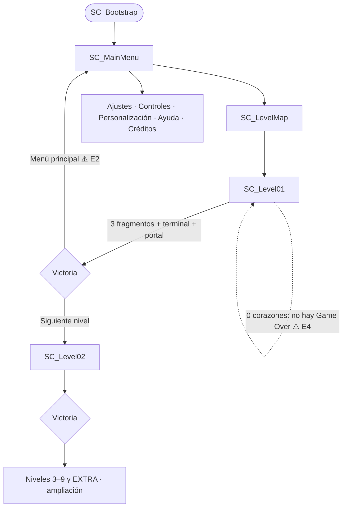

<a id="inicio"></a>
<div align="center">
  <h1>🎮 CAMPUS GLITCH</h1>
  <h3>Plataformas 2D de orientación universitaria · Unity 6000.3.16f1</h3>
  <p><strong>Un lobo recorre un campus alterado por una anomalía digital, recupera fragmentos de información y resuelve desafíos breves de orientación para estudiantes de primer semestre.</strong></p>
  <p>
    <a href="https://unity.com/"></a>
    <a href="https://learn.microsoft.com/dotnet/csharp/"></a>
    <a href="#estado"></a>
    <a href="Docs/GITFLOW_EQUIPO.md"></a>
  </p>
  <p><a href="#estado">📊 Estado</a> · <a href="#mvp">🎯 MVP</a> · <a href="#escenas">🗺️ Escenas</a> · <a href="#funcionalidades">🧩 Funcionalidades</a> · <a href="#controles">🎮 Controles</a> · <a href="#equipo">👥 Equipo</a> · <a href="#abrir-proyecto">🚀 Abrir</a> · <a href="#gitflow">🌿 Gitflow</a></p>
</div>

---

> **Rama de referencia:** `develop`. La rama `main` todavía contiene el **prototipo anterior de tres escenas** (`MenuPrincipal`, `Nivel01`, `GameOver`) y se actualizará solo mediante una release revisada.
>
> **Corte de este README:** 2026-11-06, `develop` @ `4b729e3`. El código de juego (`Assets/`, `ProjectSettings/`, `Packages/`) es idéntico al auditado en `9257b4e`, por lo que los resultados de la auditoría siguen vigentes **hasta que se integren los PR de los Issues #13, #18, #20 y siguientes**.

<a id="estado"></a>
## 📊 Estado actual en una frase

El juego tiene **18 escenas, 9 niveles + 1 extra, menús, guardado y controles de teclado, mando y táctiles**, pero **el MVP todavía no se puede completar**: el fragmento 2 del Nivel 1 es inalcanzable (E6), no existe Game Over (E4), el quiz no responde a teclado/mando (E3) y «Cancelar» borra el progreso (E1). Estos defectos están asignados en Issues y se están corrigiendo.

Fuentes: [`Docs/AUDITORIA_CLAUDE_INFORME.md`](Docs/AUDITORIA_CLAUDE_INFORME.md) (auditoría técnica del 5–6/11, histórica) y [`Docs/ESTADO_MVP_Y_PRIORIDADES.md`](Docs/ESTADO_MVP_Y_PRIORIDADES.md).

### Cómo leer los estados de este documento

| Estado | Significado |
|---|---|
| ✅ **Verificado** | Comprobado **ejecutando** el juego o pruebas PlayMode en la auditoría (indicado en la fuente). |
| 🟡 **Implementado** | El código existe y se revisó estáticamente; **falta una prueba ejecutada** que lo confirme. |
| ❌ **Defectuoso** | Existe, pero se reprodujo un error (código E*n* de la auditoría). |
| ⏳ **Pendiente** | No existe todavía o no pudo probarse (p. ej., Android sin APK). |

<a id="mvp"></a>
## 🎯 MVP obligatorio según el GDD

El documento entregado al docente ([`Docs/GDD/Guia_JARVIS_v1.0_PRESENTADA.xlsx`](Docs/GDD/Guia_JARVIS_v1.0_PRESENTADA.xlsx), preguntas 10 y 59 — celdas **C17** y **C76**) compromete **2 niveles cortos y completamente funcionales** (5–7 min cada uno) con:

- 1 personaje jugable (lobo); movimiento, salto y mordida; vida/daño básico.
- 1–2 tipos de enemigos; interacción con información universitaria; al menos 1 checkpoint por nivel.
- Un desafío final sencillo por nivel; HUD básico; menú principal, pausa y audio esencial.
- Flujo (C42): inicio → menú → **Nivel 1** → checkpoint → desafío → **Nivel 2** → checkpoint → desafío → finalización/créditos.

| Nivel MVP | Escena | Tema en el juego actual | Tema prometido en el GDD (C63/C82) | Estado |
|---|---|---|---|---|
| **Nivel 1** | `SC_Level01` | Exterior / acceso principal (NPC Guardia U; quiz «¿Qué necesitas para entrar?») | Campus y orientación: controles + reconocer espacios | ❌ No completable: fragmento 2 inalcanzable ([#18](https://github.com/vicentesystemdev/EVALUACION_MULTIMEDIA_2026/issues/18)) |
| **Nivel 2** | `SC_Level02` | Planta baja / lobby (NPC Recepcionista; quiz sobre orientación) | Vida universitaria: organización y recursos de apoyo | 🟡 Lógica de nivel ✅; recorrido físico completo sin verificar manualmente |

Los niveles 3–9 y el extra son **ampliación**: no sustituyen al MVP. El detalle requisito por requisito está en la [matriz de cumplimiento del GDD](Docs/GDD/MATRIZ_CUMPLIMIENTO_GDD.md); las propuestas de ajuste pendientes de aprobación docente están en [`PROPUESTAS_AJUSTE_v1.1.md`](Docs/GDD/PROPUESTAS_AJUSTE_v1.1.md).

<a id="escenas"></a>
## 🗺️ Las 18 escenas del build

Registradas en `ProjectSettings/EditorBuildSettings.asset`, todas en `Assets/CampusGlitch/Scenes/`. Las 18 **cargan sin errores** en la prueba Smoke PlayMode de la auditoría (✅).

| # | Escena | Contenido |
|---|---|---|
| 0 | `SC_Bootstrap` | Arranque / splash |
| 1 | `SC_MainMenu` | Menú principal |
| 2 | `SC_LevelMap` | Mapa de niveles con bloqueo/desbloqueo |
| 3 | `SC_Customization` | Personalización del lobo |
| 4 | `SC_Settings` | Ajustes (volumen, reducir destellos, subtítulos) |
| 5 | `SC_Controls` | Controles y reasignación de teclas/botones |
| 6 | `SC_Credits` | Créditos |
| 7 | `SC_Help` | Guía del jugador |
| 8 | `SC_Level01` | Nivel 1 — Exterior / acceso principal (**MVP**) |
| 9 | `SC_Level02` | Nivel 2 — Planta baja / lobby (**MVP**) |
| 10 | `SC_Level03` | Nivel 3 — Mezanine / conexión |
| 11 | `SC_Level04` | Nivel 4 — Piso 1 / laboratorios de salud |
| 12 | `SC_Level05` | Nivel 5 — Piso 2 / Ingeniería de Sistemas |
| 13 | `SC_Level06` | Nivel 6 — Piso 4 / aulas (jefe *Secuencias*) |
| 14 | `SC_Level07` | Nivel 7 — Piso 5 / Biblioteca e Innova |
| 15 | `SC_Level08` | Nivel 8 — Terraza / lounge (jefe *IF_ELSE*) |
| 16 | `SC_Level09` | Nivel 9 — Clínica odontológica (jefe *Core Glitch*) |
| 17 | `SC_Extra_Subsuelo` | Nivel EXTRA — Subsuelo de anatomía |

> **Importante para quien edite escenas:** cada escena contiene un componente `CGGame` configurado por página/nivel. **El nivel jugable se genera por código** (`CGWorld.cs`); la vista previa `CG_EDITOR_PREVIEW_2D` que se ve en el editor se destruye al iniciar. Mover objetos en la escena **no** cambia el nivel real. No usar `Campus Glitch/Reparar escenas…` ni generadores de escenas sin acordarlo: reescriben las 18 escenas.



<a id="funcionalidades"></a>
## 🧩 Funcionalidades: implementadas, verificadas y pendientes

Estado según la auditoría (`develop` @ `9257b4e`; código sin cambios hasta `4b729e3`). Las celdas se actualizarán al integrar cada PR, **solo con pruebas ejecutadas**.

| Funcionalidad | Dónde | Estado | Issue |
|---|---|---|---|
| Carga de las 18 escenas | `EditorBuildSettings.asset` | ✅ Verificado (Smoke ×18) | — |
| Lógica de misión: 3 fragmentos + terminal + (jefe) + portal → victoria, 10 niveles | `CGGame.cs` | ✅ Verificado por lógica (sin recorrido físico) | — |
| Caída al vacío → reaparición | `CGEntities.cs`, `CGGame.cs` | ✅ Verificado | — |
| Guardado JSON y recarga (`campus_glitch_save_v1.json`) | `CGData.cs` | ✅ Verificado (ida y vuelta) | — |
| Pausa con Esc | `CGGame.cs` | ✅ Verificado | — |
| Build Windows x64 | `CGBuildScenes.cs` | ✅ Compila (0 errores) y arranca sin gráficos 25 s · ⏳ prueba con render | [#16](https://github.com/vicentesystemdev/EVALUACION_MULTIMEDIA_2026/issues/16) |
| Movimiento, carrera, salto con *coyote time* | `CGEntities.cs` | ❌ Salto de 1,37 u no alcanza plataformas desde 1,86 u (E5) | [#19](https://github.com/vicentesystemdev/EVALUACION_MULTIMEDIA_2026/issues/19) |
| Fragmentos alcanzables en N1 y N8 | `CGWorld.cs` | ❌ Fragmento 2 inalcanzable (E6) | [#18](https://github.com/vicentesystemdev/EVALUACION_MULTIMEDIA_2026/issues/18) |
| Vida/daño y Game Over | `CGGame.cs`, `CGEntities.cs` | ❌ Al llegar a 0 corazones se restauran 3; no hay Game Over (E4) | [#13](https://github.com/vicentesystemdev/EVALUACION_MULTIMEDIA_2026/issues/13) |
| «Borrar progreso» → CANCELAR | `CGGame.cs` | ❌ Cancelar con Enter/A borra el progreso (E1) | [#20](https://github.com/vicentesystemdev/EVALUACION_MULTIMEDIA_2026/issues/20) |
| Terminal / quiz (desafío final) | `CGGame.cs` | ❌ Solo ratón o toque (E3) | [#21](https://github.com/vicentesystemdev/EVALUACION_MULTIMEDIA_2026/issues/21) |
| Pantalla de victoria / final | `CGGame.cs` | ❌ Ignora la opción elegida con teclado/mando (E2) | [#22](https://github.com/vicentesystemdev/EVALUACION_MULTIMEDIA_2026/issues/22) |
| Volumen general | `CGGame.cs` | ❌ Puede llegar al 105 % (E8) | — (sin Issue propio) |
| Mordida | `CGEntities.cs` | 🟡 Implementado | [#14](https://github.com/vicentesystemdev/EVALUACION_MULTIMEDIA_2026/issues/14) |
| Enemigos Bug_Terrestre, Bug_Saltador, Centinela | `CGEntities.cs` | 🟡 Patrulla y daño por distancia, sin física | [#14](https://github.com/vicentesystemdev/EVALUACION_MULTIMEDIA_2026/issues/14) |
| Jefes (Secuencias, IF_ELSE, Core Glitch; niveles 6, 8, 9) | `CGEntities.cs` | 🟡 Parcial: estáticos, el «pulso» solo muestra un texto | [#14](https://github.com/vicentesystemdev/EVALUACION_MULTIMEDIA_2026/issues/14) |
| Checkpoint (pulsar E) | `CGGame.cs` | 🟡 Implementado; manual, no automático como dice el GDD (C48) | — |
| Menú, mapa, personalización, ajustes, controles, ayuda, créditos | `CGGame.cs` (IMGUI) | 🟡 Implementado | [#11](https://github.com/vicentesystemdev/EVALUACION_MULTIMEDIA_2026/issues/11) |
| Reasignación de teclas y mando | `CGData.cs`, `CGGame.cs` | 🟡 Implementado; admite duplicados | — |
| Audio: música + SFX (salto, mordida, daño, recogida, checkpoint, denegado, victoria) | `CGAudio.cs` | 🟡 Implementado | [#12](https://github.com/vicentesystemdev/EVALUACION_MULTIMEDIA_2026/issues/12) |
| Animación del lobo por fotogramas | `CGEntities.cs` | 🟡 Implementado (sin Animator en tiempo de ejecución) | [#12](https://github.com/vicentesystemdev/EVALUACION_MULTIMEDIA_2026/issues/12) |
| Opción «Subtítulos» | `CGGame.cs` | ❌ Sin efecto (E12) | — (sin Issue propio) |
| Controles táctiles Android | `CGTouch.cs` | 🟡 Parcial: faltan Correr y Habilidad (E10) · ⏳ sin APK probado | [#10](https://github.com/vicentesystemdev/EVALUACION_MULTIMEDIA_2026/issues/10) |
| Build Android (IL2CPP, ARM64) | `CGAndroidBuild.cs` | ⏳ No verificado: falta Android Build Support en el equipo auditado | [#10](https://github.com/vicentesystemdev/EVALUACION_MULTIMEDIA_2026/issues/10) |
| Agacharse (GDD C10/C33) | — | ⏳ No implementado (propuesto como opcional, pendiente de aprobación) | — |
| Evaluación con estudiantes de primer semestre (GDD C144) | Externa al juego | ⏳ Pendiente | — |

<a id="controles"></a>
## 🎮 Controles por defecto

Valores iniciales de `CGData.cs` (reasignables en **Controles**). Comprobado por ejecución con teclado simulado: Esc (pausa), Espacio (salto) y navegación de menús con flechas/Enter. Mando y táctil: 🟡 sin prueba ejecutada.

| Acción | Teclado | Mando | Táctil (`CGTouch.cs`) |
|---|---|---|---|
| Mover | A / D | D-pad / stick izquierdo | ◀ ▶ |
| Saltar | Espacio | A (*South*) | Botón saltar |
| Correr | Shift izq. | Gatillo derecho | ⏳ falta (E10) |
| Morder | J | X (*West*) | Botón atacar |
| Interactuar | E | Y (*North*) | Botón interactuar |
| Habilidad | Q | Bumper derecho | ⏳ falta (E10) |
| Pausa | Esc | Start | Botón pausa |
| Menús | ↑/↓ o W/S, Enter/Espacio, Esc | D-pad, A, B | Toque |

<a id="equipo"></a>
## 👥 Equipo y responsabilidades

Cada fila resume **responsabilidades asignadas** y **aportes registrados en Git**. La autoría real de cada cambio está en el historial (`git log --author`), no en este README.

| Integrante | GitHub | Responsabilidad actual (Issues) | Aportes registrados en este repositorio |
|---|---|---|---|
| **Vicente Oscar Claros Mamani** | `vicentesystemdev` | Líder, administrador e integrador de PR. Documentación y Gitflow (#9), controles táctiles/Android (#10), QA del MVP y release | Proyecto base, gestor de escenas y UI de Nivel01 del prototipo (15/10); commit de integración `8c48d0a` (PR #8), que **importó** el juego desde el repositorio `CAMPUS_GLITCH`; controles táctiles `3619026` y exportación APK `9257b4e` (22/10); auditoría, Gitflow y plantillas (PR #17, #23, #24) |
| **Carla Valeria Encinas Cano** | `VarlaCdev20` | Menús y desafíos: cancelar borrado (#20), quiz con teclado/mando (#21), navegación de victoria (#22), menús y UX móvil (#11), animaciones/audio/feedback (#12) | Menú principal del prototipo (Canvas, panel, título, botones, botón Jugar) — 9 commits del 15/10 |
| **Marcelo Josue Escobar Chipana** | `Josue-EC16` | Derrota y combate: Game Over (#13), enemigos y combate (#14) | Escena y script Game Over del prototipo — 4 commits del 15/10 (PR #4) |
| **Víctor Grover Asturizaga Plata** | `Developer-vic1` | Mundo y arte: fragmento inalcanzable (#18), salto/plataformas (#19), inventario de arte (#15), QA visual Windows (#16) | Sprites, fondos y recursos gráficos del prototipo; README del prototipo — 5 commits del 15/10 |

> **Trazabilidad:** el juego actual llegó a este repositorio en **un único commit** (`8c48d0a`) que además eliminó escenas y scripts previos de Carla, Marcelo y Vicente. Ese commit **no** acredita autoría individual del código importado; el origen está en el repositorio [`CAMPUS_GLITCH`](https://github.com/vicentesystemdev/CAMPUS_GLITCH). Desde el 5/11 todo cambio entra por rama propia y PR para que cada aporte sea atribuible (ver auditoría §1 y §8).

<a id="tecnologias"></a>
## 🧰 Tecnologías

| Tecnología | Uso real en el proyecto |
|---|---|
| **Unity 6000.3.16f1**, URP 2D | Motor y render 2D (luces 2D en escenas) |
| **C#** | 8 scripts de juego en `Assets/CampusGlitch/Scripts` + 8 herramientas de editor |
| **Input System 1.19** | Lectura directa de teclado, mando y táctil (el asset `InputSystem_Actions` no se usa) |
| **IMGUI (`OnGUI`)** | Todas las pantallas de menú y HUD |
| **`Resources.Load`** | Carga de sprites, sonidos y temas por ruta |
| **JsonUtility** | Guardado en `Application.persistentDataPath` |
| **Git / GitHub** | Issues, ramas por tarea, PR a `develop`, ruleset en `main`/`develop` |

## 📁 Estructura principal

```text
EVALUACION_MULTIMEDIA_2026/
├── Assets/CampusGlitch/
│   ├── Scenes/            # 18 escenas del build (SC_*)
│   ├── Scripts/           # CGGame, CGData, CGWorld, CGEntities, CGTouch, CGAudio, CGCamera2DRuntime, CGAnimatedProp
│   ├── Editor/            # Builds Windows/Android, validadores, generador de escenas (¡reescribe escenas!)
│   └── Resources/CG/      # Sprites, fondos, temas, sonidos y efectos cargados por código
├── Docs/
│   ├── AUDITORIA_CLAUDE_INFORME.md     # Auditoría técnica histórica (5–6/11)
│   ├── ESTADO_MVP_Y_PRIORIDADES.md     # Bloqueantes e Issues
│   ├── GITFLOW_EQUIPO.md               # Protocolo de ramas, PR y liderazgo
│   ├── Equipo/                         # Instrucciones por integrante y aviso de PR
│   ├── GDD/                            # GDD original (no editar), propuestas y matriz de cumplimiento
│   └── QA/                             # Plantilla MVP y matrices de QA de PR
└── .github/PULL_REQUEST_TEMPLATE.md
```

<a id="abrir-proyecto"></a>
## 🚀 Cómo abrir y probar

**Requisitos:** Unity Hub, **Unity 6000.3.16f1** (con *Windows Build Support*; *Android Build Support* para APK) y Git.

```bash
git clone https://github.com/vicentesystemdev/EVALUACION_MULTIMEDIA_2026.git
cd EVALUACION_MULTIMEDIA_2026
git switch develop
```

1. **Unity Hub → Add project from disk** → carpeta que contiene `Assets`, `Packages` y `ProjectSettings`.
2. Abrir `Assets/CampusGlitch/Scenes/SC_Bootstrap.unity` y pulsar **Play**.
3. Menú → **Jugar** → mapa → **Nivel 1**.
4. Para QA del MVP, usar [`Docs/QA/PLANTILLA_MVP_NIVELES_1_2.md`](Docs/QA/PLANTILLA_MVP_NIVELES_1_2.md) y registrar solo resultados ejecutados.

> El guardado se escribe en `%USERPROFILE%\AppData\LocalLow\DefaultCompany\CAMPUS_GLITCH_TEMP\campus_glitch_save_v1.json` (según `companyName`/`productName` actuales). Bórralo (o usa «Borrar progreso» cuando #20 esté integrado) para probar desde cero.

<a id="gitflow"></a>
## 🌿 Gitflow

- `main` y `develop` están protegidas por un ruleset: **PR obligatorio, 1 aprobación, conversaciones resueltas, sin force push ni borrado**.
- Cada tarea se trabaja en `feature|fix|docs|test/<persona>/<Issue>-<tema>` desde `origin/develop` y se integra con **Create a merge commit**.
- Vicente revisa e integra los PR de los compañeros; sus propios PR se rigen por la excepción documentada en [`Docs/GITFLOW_EQUIPO.md` §0](Docs/GITFLOW_EQUIPO.md).
- Tras publicar o actualizar un PR, avisar a Vicente con [`Docs/Equipo/05_PLANTILLA_AVISO_PR.md`](Docs/Equipo/05_PLANTILLA_AVISO_PR.md).

Más detalle: [`Docs/GITFLOW_EQUIPO.md`](Docs/GITFLOW_EQUIPO.md) y [`Docs/Equipo/00_PROTOCOLO_COMUN_IA_GITFLOW.md`](Docs/Equipo/00_PROTOCOLO_COMUN_IA_GITFLOW.md).

---

<p align="center"><strong>🐺 Un campus. Dos niveles obligatorios. Un equipo.</strong><br>
<sub>Proyecto académico de Multimedia y Videojuegos · Unity 2D</sub><br>
<a href="#inicio">⬆️ Volver al inicio</a></p>
