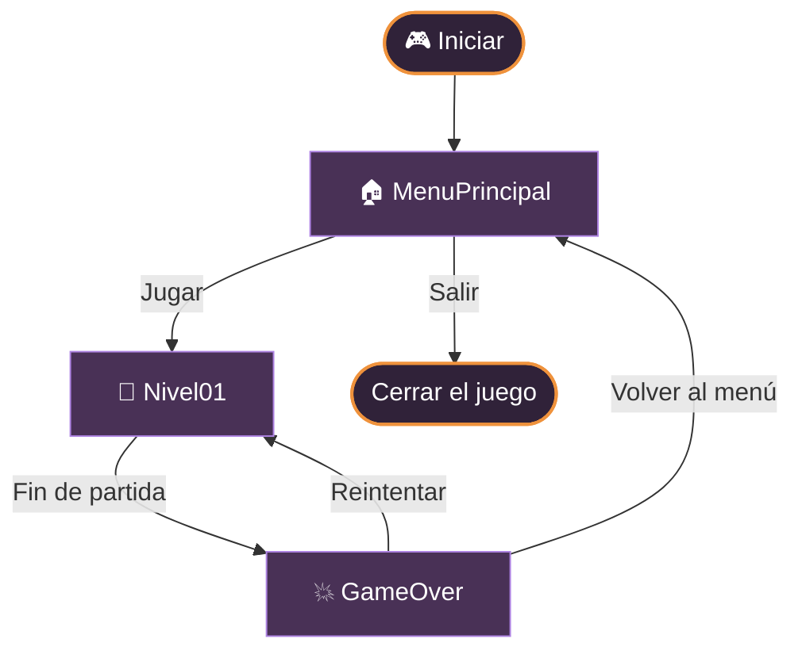
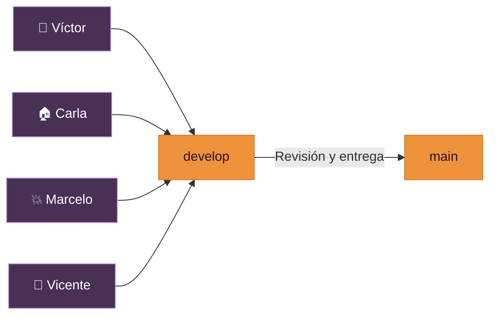

<a id="inicio"></a>
<div align="center">
  <h1>🎮 CAMPUS GLITCH</h1>
  <h3>Evaluación práctica de Multimedia y Videojuegos · Unity 2D</h3>
  <p><strong>Un pequeño prototipo universitario, cuatro responsabilidades y un mismo objetivo:</strong><br>
  conectar el menú principal, un nivel de juego y una pantalla de fin de partida, reutilizando el arte de <strong>CAMPUS_GLITCH</strong>.</p>
  <p>
    <a href="https://unity.com/"></a>
    <a href="https://learn.microsoft.com/dotnet/csharp/"></a>
    <a href="https://github.com/vicentesystemdev/EVALUACION_MULTIMEDIA_2026"></a>
    <a href="https://git-scm.com/"></a>
  </p>
  <p><a href="#abrir-proyecto">🚀 Empezar</a> · <a href="#flujo">🗺️ Flujo del juego</a> · <a href="#equipo">👥 Equipo</a> · <a href="#gitflow">🌿 Ramas</a> · <a href="#recursos">📁 Recursos</a></p>
</div>

---

<a id="vision"></a>
## ✨ ¿De qué trata este proyecto?

**EVALUACION_MULTIMEDIA_2026** es un trabajo colaborativo desarrollado en **Unity 2D**. El objetivo de la práctica es integrar tres escenas, utilizar controles de interfaz y comprobar la navegación con `SceneManager`.

Tomamos como punto de partida los sprites, fondos, paneles y personajes del proyecto [CAMPUS_GLITCH original](https://github.com/vicentesystemdev/CAMPUS_GLITCH/tree/feature/develop_victor_asturizaga). **No pretendemos reconstruir el juego original completo:** esta entrega se concentra en una versión pequeña, clara y verificable para el examen.

<table>
<tr>
<td align="center" width="33%"><strong>🏠 Menú principal</strong><br><sub>Jugar · Salir</sub></td>
<td align="center" width="34%"><strong>🐺 Nivel 01</strong><br><sub>Escena de juego y condición de derrota</sub></td>
<td align="center" width="33%"><strong>💥 Game Over</strong><br><sub>Reintentar · Volver al menú</sub></td>
</tr>
</table>

<a id="flujo"></a>
## 🗺️ Flujo del juego



> **Nota:** este diagrama representa el **flujo esperado de la entrega**. La existencia de un método o una escena no confirma, por sí sola, que todos los botones y eventos estén conectados y probados.

<details>
<summary><strong>🔎 Ver las acciones previstas por pantalla</strong></summary>

| Pantalla | Elemento | Acción esperada |
|---|---|---|
| `MenuPrincipal.unity` | **Jugar** | `GestorEscenas.IniciarJuego()` |
| `MenuPrincipal.unity` | **Salir** | `GestorEscenas.SalirDelJuego()` |
| `Nivel01.unity` | **Fin de partida** | `GestorEscenas.MostrarGameOver()` |
| `GameOver.unity` | **Reintentar** | `GestorEscenas.ReiniciarNivel()` |
| `GameOver.unity` | **Volver al menú** | `GestorEscenas.VolverAlMenu()` |

Los métodos están definidos en `Assets/Scripts/Core/GestorEscenas.cs` de la rama `develop`; su conexión final y las pruebas corresponden a la integración del equipo.

</details>

<a id="equipo"></a>
## 👥 Equipo y responsabilidades

Cada integrante trabaja en su parte; la integración final une los resultados sin reemplazar el trabajo de los demás.

<details open>
<summary><strong>🎨 Víctor — Recursos gráficos y estilo visual</strong></summary>

- Prepara sprites de **botones, fondos y paneles** a partir de CAMPUS_GLITCH.
- Revisa su importación en Unity y conserva los archivos `.meta`.
- Organiza recursos compartidos y prepara referencias visuales para las otras escenas.
- **No** implementa los menús funcionales ni las mecánicas de juego.

**Rama:** [`feature/victor-integracion`](https://github.com/vicentesystemdev/EVALUACION_MULTIMEDIA_2026/tree/feature/victor-integracion)

</details>

<details>
<summary><strong>🏠 Carla — Menú principal</strong></summary>

- Construye `MenuPrincipal.unity` con **Canvas**, título, fondo y botones **Jugar** y **Salir**.
- Utiliza **TextMeshPro**, el Inspector y los eventos **OnClick**.
- Conecta las acciones públicas del gestor de escenas.

**Rama:** [`feature-carla-integracion`](https://github.com/vicentesystemdev/EVALUACION_MULTIMEDIA_2026/tree/feature-carla-integracion)

</details>

<details>
<summary><strong>💥 Marcelo — Pantalla Game Over</strong></summary>

- Construye `GameOver.unity` con el mensaje de fin de partida.
- Agrega los botones **Reintentar** y **Volver al menú**.
- Adapta los recursos visuales compartidos por Víctor.

**Rama:** [`feature/gameover`](https://github.com/vicentesystemdev/EVALUACION_MULTIMEDIA_2026/tree/feature/gameover)

</details>

<details>
<summary><strong>🔗 Vicente — Navegación, integración y entrega</strong></summary>

- Mantiene `GestorEscenas.cs` y revisa `Nivel01.unity`.
- Integra las transiciones, coordina los **Pull Requests** y ejecuta pruebas.
- Organiza las capturas y el **PDF de entrega de 1–2 páginas**.

**Rama:** [`feature/vicente-integracion`](https://github.com/vicentesystemdev/EVALUACION_MULTIMEDIA_2026/tree/feature/vicente-integracion)

</details>

<a id="tecnologias"></a>
## 🧰 Tecnologías y conceptos

| Tecnología | Uso en el proyecto |
|---|---|
| **Unity 6000.3.16f1** | Editor y escenas 2D |
| **C#** | Gestor de escenas y scripts |
| **Canvas / Button / Image** | Construcción de interfaces |
| **TextMeshPro** | Textos de los menús |
| **SceneManager** | Transición entre pantallas |
| **PNG / Aseprite** | Recursos y fuentes de pixel art |
| **Git y GitHub** | Ramas, commits, revisiones y Pull Requests |

<a id="estructura"></a>
## 📁 Estructura del proyecto

La estructura puede variar entre ramas hasta completar la integración:

```text
EVALUACION_MULTIMEDIA_2026/
├── Assets/
│   ├── Scenes/
│   │   ├── MenuPrincipal.unity
│   │   ├── Nivel01.unity
│   │   └── GameOver.unity
│   ├── Scripts/
│   │   └── Core/
│   │       └── GestorEscenas.cs         # En develop
│   ├── Prefabs/
│   ├── Art/                           # En la rama gráfica
│   │   ├── PNG/
│   │   ├── Aseprite/
│   │   └── Animaciones/
│   └── Editor/
├── Packages/
├── ProjectSettings/
├── Docs/                                # Documentación por ramas
└── README.md
```

> En la rama `main` puede aparecer únicamente la **base inicial** mientras el equipo trabaja en sus ramas y fusiona los cambios. Consulta [`develop`](https://github.com/vicentesystemdev/EVALUACION_MULTIMEDIA_2026/tree/develop) para la integración y las ramas individuales para cada entrega.

<a id="recursos"></a>
## 🎨 Recursos gráficos

La identidad visual reutiliza el pixel art y los elementos del juego original. Estos sprites están en la rama de Víctor:

`Assets/Art/PNG/01_Nuevos_Modulares/Global_UI/`

| Recurso | Aplicación prevista |
|---|---|
| `ButtonOrangeNormal.png` | Botón en reposo |
| `ButtonOrangeHover.png` | Botón con el cursor encima |
| `ButtonOrangePressed.png` | Botón pulsado |
| `MenuPanel.png` | Panel de menú |
| `DialogueFrame.png` | Marco de mensajes |
| `HeartFull.png` y `HeartEmpty.png` | Indicador gráfico de vidas |
| `EnergyBarFill.png` y `EnergyBarEmpty.png` | Indicador gráfico de energía |

<details>
<summary><strong>🖼️ ¿Cómo se usan los tres estados de un botón?</strong></summary>

En el componente `Button` del Inspector de Unity:

1. Asigna `ButtonOrangeNormal.png` al componente **Image**.
2. Elige **Transition → Sprite Swap**.
3. Asigna `ButtonOrangeHover.png` como **Highlighted Sprite**.
4. Asigna `ButtonOrangePressed.png` como **Pressed Sprite**.
5. Agrega el texto usando **TextMeshPro** y conecta **OnClick** desde la escena del integrante responsable.

Antes de la integración se deben revisar **Filter Mode**, **Sprite Mode**, escalado y referencias `.meta` para evitar imágenes borrosas o deformadas.

</details>

<details>
<summary><strong>🧩 Ver el plan de entrega visual de Víctor</strong></summary>

- [Mapa de carpetas y destinatarios](https://github.com/vicentesystemdev/EVALUACION_MULTIMEDIA_2026/blob/feature/victor-integracion/Docs/MAPA_CARPETAS_RECURSOS_VICTOR.md)
- [Plan de entregas visuales](https://github.com/vicentesystemdev/EVALUACION_MULTIMEDIA_2026/blob/feature/victor-integracion/Docs/PLAN_ENTREGAS_VISUALES_VICTOR.md)

**Importante:** las referencias `Referencia_Menu_Victor.unity`, `Referencia_GameOver_Victor.unity` y `Referencia_HUD_Muerte_Victor.unity` están **planificadas**, pero no deben considerarse entregadas hasta crearse y verificarse en Unity. No sustituirán las escenas oficiales.

</details>

<a id="abrir-proyecto"></a>
## 🚀 Cómo abrir el proyecto

**Requisitos:** Unity Hub, **Unity Editor 6000.3.16f1** y Git.

```bash
git clone https://github.com/vicentesystemdev/EVALUACION_MULTIMEDIA_2026.git
cd EVALUACION_MULTIMEDIA_2026
# Para consultar la integración disponible:
git switch develop
```

1. Abre **Unity Hub → Add project from disk**.
2. Selecciona la carpeta `EVALUACION_MULTIMEDIA_2026` (la que contiene `Assets`, `Packages` y `ProjectSettings`).
3. Ábrela con la versión indicada y espera a que Unity importe los recursos.
4. Desde **Project → Assets → Scenes**, abre la escena que deseas revisar.
5. Comprueba las escenas incluidas en **File → Build Profiles → Scene List** (o la sección equivalente de tu versión del editor).
6. Ejecuta **Play** para probar la parte ya integrada. Si una interfaz todavía está vacía, revisa su rama: puede seguir en desarrollo.

<details>
<summary><strong>🛠️ Solución rápida de dudas frecuentes</strong></summary>

**¿Por qué veo pantallas vacías?**  
Las escenas oficiales se crearon inicialmente como base. El contenido visual se integra progresivamente desde las ramas del equipo.

**¿Por qué no encuentro los sprites al usar `main`?**  
El trabajo gráfico está disponible en `feature/victor-integracion` mientras se revisa su integración.

**¿Debo subir `Library/`, `Temp/` o `.codex/`?**  
No. Son archivos generados o configuraciones locales. Utiliza el `.gitignore` del proyecto.

**¿Debo borrar los `.meta` de Unity?**  
No. Ayudan a conservar los identificadores y las referencias de los recursos entre equipos.

</details>

<a id="gitflow"></a>
## 🌿 Trabajo con GitFlow

Cada integrante realiza sus cambios en su rama y solicita revisión antes de integrar:



[**🔀 Comparar la rama de Víctor con `develop`**](https://github.com/vicentesystemdev/EVALUACION_MULTIMEDIA_2026/compare/develop...feature/victor-integracion) · [**🌿 Ver todas las ramas**](https://github.com/vicentesystemdev/EVALUACION_MULTIMEDIA_2026/branches) · [**📋 Revisar Pull Requests**](https://github.com/vicentesystemdev/EVALUACION_MULTIMEDIA_2026/pulls)

<details>
<summary><strong>📋 Lista de verificación previa a la entrega</strong></summary>

- [ ] `MenuPrincipal.unity` muestra título, fondo y botones correctamente.
- [ ] **Jugar** carga `Nivel01` y **Salir** responde correctamente.
- [ ] La condición de derrota conduce a `GameOver`.
- [ ] **Reintentar** vuelve al nivel y **Volver al menú** regresa al inicio.
- [ ] Los recursos gráficos se visualizan sin referencias faltantes.
- [ ] Las escenas finales están registradas en Build Profiles.
- [ ] No hay errores de compilación pendientes atribuibles a la integración.
- [ ] Los Pull Requests necesarios están revisados e integrados.
- [ ] Se prepararon las **dos capturas** y el **PDF de 1–2 páginas**.

*Esta lista es una guía de revisión; no cambia automáticamente al hacer commits.*

</details>

---

<p align="center"><strong>🐺 Un campus. Tres escenas. Un equipo.</strong><br>
<sub>Proyecto académico de Multimedia y Videojuegos · Unity 2D</sub><br>
<a href="#inicio">⬆️ Volver al inicio</a></p>
